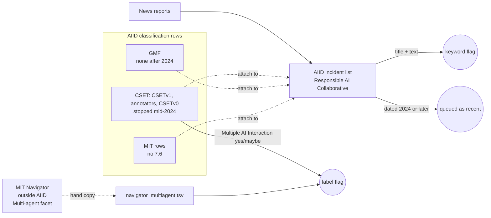

# AIID background for analysts

**Summary.** The AI Incident Database (AIID) is our baseline source of real-world incidents.
It holds two different things: an incident list, built from news reports, and classification
rows that separate teams attach to those incidents later. Only one classification field ever
asks whether several AI systems interacted, and nobody has filled it in since mid-2024. So
for incidents from 2024 on, AIID's labels tell us almost nothing about multi-agent risk, and
our pipeline has to rely on its own keyword net and on human reading.

Facts about organisations were checked on the web on 2026-11-16 (see "Sources checked" at
the end). Counts come from this project's own snapshot in `0.2/raw/aiid/`, fetched
2026-11-15.

## What AIID is

- AIID is a public database of AI failures and harms that happened in the real world [S1].
- It is "a project of the Responsible AI Collaborative", an organisation set up to run it
  [S1]. The about page links US tax-exempt filings; its exact legal form and founding date
  are **not confirmed** from the pages checked.
- An **incident** is one event, such as a car striking a pedestrian. AIID gives no single
  formal definition; it uses "an adaptive criteria" borrowed from aviation safety [S2].
- A **report** is a news article or other document about an incident. One incident usually
  has several reports. (AIID's pages imply this rather than state it [S1].)

## Incidents and classifications are different things

This is the most important idea on this page.

- The **incident list** is AIID's own work: editors accept reports and group them into
  incidents.
- **Classifications** are added afterwards by outside teams. Each team brings its own
  taxonomy, also called a **namespace**: a fixed list of questions (attributes) with allowed
  answers. AIID says taxonomies are "contributed" by people and organisations, who stay
  responsible for them [S3].
- A classification row is one team's answer sheet for one incident. An incident can have
  zero, one or many such rows.

In our snapshot:

| file | rows | one row is |
|---|---|---|
| `incidents.jsonl` | 1,817 | one incident |
| `classifications.jsonl` | 2,623 | one taxonomy annotation, not one incident |

A classification row points to its incident through its `incidents` list, which holds the
incident's internal `_id` (not the public incident number).

## The namespaces

| namespace | made by | what it records | still applied? |
|---|---|---|---|
| `CSETv1` | Center for Security and Emerging Technology, Georgetown University [S4, S5] | harms, entities, technologies and circumstances of an incident [S4]; includes `Multiple AI Interaction` | **No.** "Annotation work has been discontinued"; applied June 2022 to June 2024 [S5] |
| `CSETv1_Annotator-1/-2/-3` | same team | the same attributes, one row per individual annotator before consensus | No, same as above |
| `CSETv0` | CSET, first edition (CSETv1 calls itself "the second edition") [S4] | older harm attributes | No; all 100 rows are before 2024 in our data. No public end date **confirmed** |
| `GMF` | maintained by Nikiforos Pittaras, with Sean McGregor as contributor [S6] | Goals, Methods and Failures: the AI's goal, its technology, and its likely technical failure, each as "known" or "potential" [S6] | **Not confirmed** on the web. In our data only 21 rows date from 2024 and none from 2025 on |
| `MIT` | classifications "generated automatically through the work of Simon Mylius" [S7], using the MIT AI Risk Repository taxonomy | Risk Domain, Risk Subdomain, Entity, Intent, Timing [S7] | Yes in practice: our data has 410 rows for 2025 and 100 for 2026 |

What the terms mean:

- **Consensus row.** CSET had each incident classified by two annotators, then peer
  reviewed [S4]. `CSETv1` is the agreed result; the `Annotator-*` namespaces keep each
  person's answers, so disagreement can be seen.
- **Entity / Intent / Timing.** The MIT "causal" questions: was the cause an AI or a human,
  was the outcome intended, did it happen before or after deployment [S7, S9].
- **Risk Domain / Subdomain.** The MIT "domain" taxonomy: 7 domains and 24 subdomains [S9].

### Rows and coverage per namespace

| namespace | rows | incidents before 2024 | 2024 | 2025 | 2026 |
|---|---:|---:|---:|---:|---:|
| MIT | 1,498 | 695 | 293 | 410 | 100 |
| GMF | 326 | 305 | 21 | 0 | 0 |
| CSETv1 (consensus) | 214 | 214 | 0 | 0 | 0 |
| CSETv1_Annotator-1 | 298 | 294 | 4 | 0 | 0 |
| CSETv1_Annotator-2 | 106 | 106 | 0 | 0 | 0 |
| CSETv1_Annotator-3 | 81 | 81 | 0 | 0 | 0 |
| CSETv0 | 100 | 100 | 0 | 0 | 0 |

Year columns count incidents covered, by incident date.

## The MIT AI Risk Repository and its Navigator

- The **MIT AI Risk Repository** is "a living database of 1,700+ AI risks from 65
  frameworks", run by the MIT AI Risk Initiative at MIT FutureTech [S8].
- Its domain taxonomy has a subdomain **7.6 "Multi-agent risks"**, described as "risks from
  multi-agent interactions" [S9].
- The **AI Incident Tracker** classifies about 1,600 AIID incidents by risk domain, cause,
  harm and severity. Its classification runs through Arcola AI's LLM pipeline, and the page
  says "a systematic validation study has not yet been completed" [S10].
- The **Navigator** (`airisk.mit.edu/navigator`) is the browsing interface that joins the
  initiative's datasets [S8]. It is a JavaScript app; its content could **not** be fetched,
  so its "Multi-agent" behaviour facet and its "research prototype" status are **not
  confirmed** on the web today. They are recorded in `RESOURCES.md` from a browser visit.

How this relates to the `MIT` rows inside AIID:

- The `MIT` namespace in AIID is a copy of an MIT-taxonomy classification run. AIID's own
  page for it lists subdomains 7.1 to 7.5 only [S7]; the values actually present in our data
  stop at **7.4**. Subdomain 7.6 never appears.
- The Navigator does use a multi-agent facet. On 2026-11-09 it returned **28** AIID
  incidents. The AIID API does not carry that facet, so the list was copied by hand into
  `0.2/registry/labels/navigator_multiagent.tsv`.
- In short: the MIT team's multi-agent judgement lives on the MIT website, not in AIID.

## The one AIID field that asks the multi-agent question

`CSETv1` attribute `Multiple AI Interaction`, at `attributes[].short_name`, values
`yes` / `no` / `maybe`. Its definition could **not** be confirmed on the web: AIID's CSETv1
page and CSET's repository front page do not show it [S4, S5]; the annotation guide PDF
was not read.

| consensus value | incidents |
|---|---:|
| no | 195 |
| yes | 5 (incidents 7, 19, 25, 44, 125) |
| maybe | 1 (incident 47) |
| blank | 12 |

- 313 incidents carry a value in any CSETv1 namespace. None is dated 2025 or later.
- 319 incidents have no classification of any kind; most are recent.
- CSET's `yes` does not mean what we mean. See `OPEN.md` item 23.

### What that means by year

| incident year | incidents | with a multi-agent value | classified by MIT or GMF only | no classification |
|---|---:|---:|---:|---:|
| before 2024 | 714 | 309 | 386 | 19 |
| 2024 | 315 | 4 | 289 | 22 |
| 2025 | 469 | 0 | 410 | 59 |
| 2026 | 319 | 0 | 100 | 219 |

From 2024 on, almost nothing in AIID has been asked the multi-agent question.

## Why this matters for our pipeline

The project rule (`CLAUDE.md`): **an external label may mark a candidate; it may never, by
itself, put an incident in scope.** Only a human verdict does that.

The prefilter (`run.py`, step `prefilter`) queues a record for one reason, its `basis`:

| basis | a record is queued when |
|---|---|
| `recent` | it is an AIID record dated 2024-01-01 or later, whatever any label says |
| `frozen` | it is on the hand-kept list of pre-2024 candidates, `0.2/registry/frozen_pre2024.csv` |
| `manual` | the curator added it by hand |

It then flags a queued record, in `flags`, when an outside label or a keyword says it may be
multi-agent:

| flag | set when | label source |
|---|---|---|
| `label` | CSETv1 says `yes` or `maybe`, or the incident is in the Navigator list | external |
| `keyword` | a word net matches the title and text | ours |

The CSETv1 labels stop in 2024, so they cannot be what decides which recent records are
queued. Until 2026-11-17 the prefilter had three arms (`label`, `keyword`, `unasked`) and a
CSETv1 `no` kept a recent record out; four such records are queued now. `docs/input_layer.md`
says what changed. The section "The blind spot" below is the history of the `unasked` arm.

### The blind spot

*History, as of 2026-11-16: the `unasked` arm described here was replaced on 2026-11-17 by
the `recent` basis, which queues every AIID record dated 2024 or later.*

This is the gap the old third arm left, and the reason it was widened. An incident from
2024 on that MIT or GMF classified looked "classified", so the old `unclassified` arm
skipped it. Yet neither MIT's AIID rows nor GMF ever ask the multi-agent question. **772**
such incidents had been seen only by the keyword net:

| year | incidents seen by keyword net only |
|---|---:|
| 2024 | 282 |
| 2025 | 398 |
| 2026 | 92 |

**Measured 2026-11-16.** A random sample of 100 of these incidents, drawn evenly across the
three years, was read from the record text. 78 described one agent or none. 22 needed their
source read: 18 where the text could not tell, 4 with several agents. At least three looked
like real candidates, and none had matched a keyword. So the third arm was widened: it now
catches every incident from 2024 on that **nobody asked the multi-agent question**, whether
or not MIT or GMF classified it. The arm is called `unasked`. See `OPEN.md` item 60.

### Rules of thumb

- Treat a CSETv1 `no` as weak evidence: it covers few incidents, none recent.
- Treat a missing label as "not asked", never as "not multi-agent".
- A record flagged `label` or `keyword` is never dismissed on its record text alone
  (the flag rule, `docs/context_layer.md`).
- Inherited labels go in `external_labels` and are never merged with ours.

## Sources checked

All fetched 2026-11-16.

- [S1] https://incidentdatabase.ai/about/ : what AIID is; run by the Responsible AI
  Collaborative.
- [S2] https://incidentdatabase.ai/research/1-criteria/ : adaptive incident criteria.
- [S3] https://incidentdatabase.ai/taxonomies/ : taxonomies are contributed; CSETv1, GMF,
  MIT listed as applied taxonomies.
- [S4] https://incidentdatabase.ai/taxonomy/csetv1/ : second edition; two annotators, peer
  review; what it records.
- [S5] https://github.com/georgetown-cset/CSET-AIID-harm-taxonomy : applied June 2022 to
  June 2024; "Annotation work has been discontinued".
  https://cset.georgetown.edu/about-us/ : CSET is the Center for Security and Emerging
  Technology at Georgetown University.
- [S6] https://incidentdatabase.ai/taxonomy/gmf/ : Goals, Methods and Failures;
  maintainer and contributor.
- [S7] https://incidentdatabase.ai/taxonomy/mit/ : five fields; generated automatically
  by Simon Mylius; subdomains listed 7.1 to 7.5.
- [S8] https://airisk.mit.edu/ : Repository, MIT AI Risk Initiative, MIT FutureTech,
  Navigator link.
- [S9] https://airisk.mit.edu/risks : causal taxonomy; 7 domains, 24 subdomains; 7.6
  Multi-agent risks.
- [S10] https://airisk.mit.edu/ai-incident-tracker : about 1,600 AIID incidents; Arcola
  AI LLM pipeline; not yet validated.

Not confirmed: the Navigator page content (JavaScript only); the definition of `Multiple AI
Interaction`; whether GMF is still applied; CSETv0's dates and end; the Responsible AI
Collaborative's legal form and founding date.
