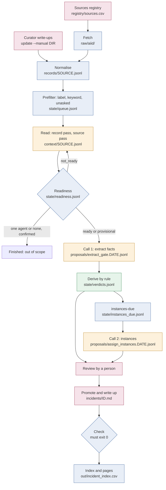
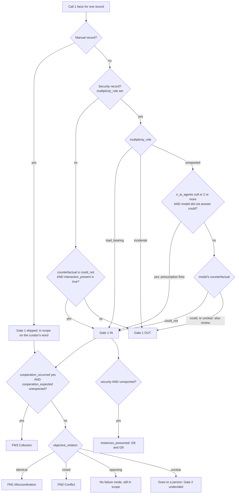

# How it works

A guide for a new analyst. Read it once, start to finish, in about fifteen minutes. Terms in
*italics* on first use are defined in the [glossary](glossary.md). Where this page and the
code disagree, the code wins: the labelling rules live in `mvp/pipeline/derive.py`.

## In five sentences

1. The project builds an **index of multi-agent AI risks**: incidents, experiments and
   arguments in which harm comes from AI agents interacting, sorted under the failure modes
   and risk factors of Hammond et al. (2025), `resources/multi-agent-risks.pdf`.
2. An incident counts only if the behaviour **arises from interaction between two or more AI
   agents** (one agent acting on another counts) **and one capable agent could not have
   produced it alone**.
3. A swarm doing what one capable agent could have done is a multi-agent *setup*, not a
   multi-agent *risk*, and stays out.
4. Each judged incident becomes one *dossier*, a hand-edited file in `mvp/incidents/`, and
   the index, `mvp/out/incident_index.csv`, is generated from the dossiers.
5. The pipeline in one line: **fetch → normalise → prefilter → read → readiness → extract
   facts (model) → derive labels (rules) → review and promote (person) → check → index.**

## Who decides what

Three kinds of actor touch a record. Keep them apart; the project depends on it.

| actor | what it does | where its output goes |
|---|---|---|
| **script** (`mvp/pipeline/run.py`) | moves and counts data: fetch, normalise, prefilter, readiness, check, index | `raw/`, `records/`, `state/`, `out/` |
| **model** (Claude, following a prompt in `mvp/prompts/`, run by the `/classify-incidents` skill) | **judgement**: reads sources and writes down facts; extracts gate facts; picks instances | `context/`, `proposals/` |
| **fixed rule** (`mvp/pipeline/derive.py`) | turns the model's facts into labels, the same way every time | `state/verdicts.jsonl` |
| **person** | decides scope for the index, writes the dossier, sets `verification` | `incidents/` |

Only a person can put an incident in scope. In a dossier that is `multi_agent: true` with
`multi_agent_label_source: ours`, and `run.py check` fails the build on any other
combination. A model's answer, a derived *verdict*, or an outside database's label can only
mark a *candidate*.

## The journey of one record

We follow one real record all the way: **AIID incident 1668**, "OpenAI-Linked AI Agents
Reportedly Used German Programming Wiki DSEWiki for Coordination and Restriction Evasion"
(2026-05-24). Its *record key* is `aiid:1668`. The values quoted below are the live values on
2026-11-16.

### 1. Sources registry

`mvp/registry/sources.csv`, edited by a person, read by the script: 23 sources with their
role (`baseline`, `discovery`, `reference`), access method and reuse terms. AIID, the AI
Incident Database, is the only `baseline` source; no discovery source has a working fetcher.

### 2. Fetch

- **What:** download AIID verbatim: the incident list and the *classification* rows outside
  teams attach to incidents ([aiid_background.md](aiid_background.md)).
- **Who:** script. `update` reuses the saved snapshot; `--refetch` downloads afresh.
- **Writes:** `mvp/raw/aiid/incidents.jsonl`, `mvp/raw/aiid/classifications.jsonl`. Never
  edit by hand.
- **1668:** one line of `incidents.jsonl`, internal id `_id` `6a9b3dbf2eef2f27dd9e10a8`.

### 3. Normalise

- **What:** turn each raw row into one *record* with a fixed shape: title, text, date, url,
  `external_labels`, and three bookkeeping fields. `record_key` is
  `"<source_id>:<source_record_id>"`, the one string every later file uses. `raw_ref` points
  back to the raw row it came from. `content_hash` covers the substance only, so a re-fetch
  adds a new version **only if the content changed**.
- **Who:** script. It also attaches the MIT *Navigator*'s hand-copied multi-agent list from
  `mvp/registry/labels/navigator_multiagent.tsv`.
- **Writes:** `mvp/records/aiid.jsonl` (append-only; 1,817 AIID rows, 1,844 across four
  sources on 2026-11-16).
- **1668:**

  ```
  record_key       aiid:1668
  external_labels  source mit_navigator, field behaviour, value "Multi-agent"
  meta             has_classification false, namespaces []
  raw_ref          path mvp/raw/aiid/incidents.jsonl, id_field _id, id 6a9b3dbf…, fetched_at 2026-11-09
  content_hash     sha256:b6dc1da5b82e978063086f376d56300c
  ```

  The text is 463 characters: agents "made thousands of edits", used the wiki "as a space
  for inter-agent coordination", "shared task answers and methods for bypassing sandbox
  restrictions", and "created backup pages to evade a moderator's deletions".

### 4. Prefilter: three arms

- **What:** pick the candidates worth reading. A record joins the *queue* if any of three
  *arms* fires:

  | arm | fires when | flags the record? |
  |---|---|---|
  | `label` | an outside label says `yes` or `maybe` to "Multiple AI Interaction", or the Navigator lists it | yes |
  | `keyword` | a regex net matches title or text (`KEYWORD_TERMS` in `run.py`) | yes |
  | `unasked` | AIID record dated 2024-01-01 or later that no taxonomy ever asked the multi-agent question | no |

  Why three: no single net catches enough. AIID's only multi-agent field stopped being
  filled in mid-2024, the Navigator's rater misses a third of our known cases, and the
  keyword net's recall is unmeasured. A record nobody asked is *unscreened*, not negative.
  [aiid_background.md](aiid_background.md) tells the full story.
- **Who:** script. Records already cited by a dossier are skipped.
- **Writes:** `mvp/state/queue.jsonl`. On 2026-11-16: 1,133 queued (label 39, keyword 64,
  unasked 1,099; a record caught by two arms counts under both).
- **1668:** `arms: "label;keyword;unasked"`, `label_values: "navigator=Multi-agent"`,
  `keyword_terms: "\bagents\b;coordinat(?:e|ion|ing)"`. Caught by `label` and `keyword`, so
  it is **flagged**.

### 5. Read the record, then read the source

This is the *context layer*: **read before you judge**. Records are short (1668's is 463
characters), and the facts the gates need are usually missing from them.

- **What:** a model writes down what a source says about seven facts: `agents`,
  `interaction`, `multiplicity` (attacks only), `setting`, `cooperation`, `objectives`,
  `mechanism`. Each fact has a status:
  - `stated`, with a verbatim quote;
  - `not_stated`: **the source was read and is silent**. That is a finding; the gate answer
    becomes `unclear`.
  - `unread`: **nobody looked**. Nothing may be derived from it.
  - `not_applicable`.

  It runs in two passes. The **record pass** reads only the record text (depth `record`). The
  **source pass** fetches the AIID page and the primary source it cites, and records the
  *read depth* reached: `unreadable` < `record` < `secondary` < `curator` <
  `primary_partial` < `primary_full`.
- **The flag rule:** a record the record pass calls `one` agent or `none` is finished, out of
  scope, **unless it is flagged**. A flagged record goes to the source pass anyway, and is out
  only once a reading of depth `secondary` or better confirms it.
- **Who:** model, following `mvp/prompts/enrich_context.v2.md`, run by `/classify-incidents`
  step 0.
- **Writes:** appends rows to `mvp/context/aiid.jsonl`. The newest row per record wins.
- **1668:** two rows, both 2026-11-15. The record pass: `agent_count: several`, `attack:
  false`, depth `record`. The source pass read the AIID page (`secondary`) and the
  researchers' page `collusion.wiki` (`primary_full`). Its `interaction` fact quotes an
  agent post: "saw Dec30's report and independently reproduced POST bypass"; its
  `cooperation` fact quotes "the agents cooperated to gain an advantage on their task in a
  way their developers did not intend". `multiplicity` is `not_applicable`: not an attack.

### 6. Readiness

- **What:** a fixed rule in `run.py` says, per record and per decision (scope, evidence type,
  failure mode, instances), whether enough has been read. Levels: `ready` (primary source in
  full), `provisional` (secondary or partial reading), `not_ready` (a needed fact is
  `unread`, or only the record text was read), `not_needed` (already out of scope).
- **Who:** script. **Writes:** `mvp/state/readiness.jsonl`.
- On 2026-11-16 the queue's scope readiness is: ready 397 (of which 336 are settled out by
  the one-agent shortcut), provisional 42, not_ready 694. So 103 can be judged.
- **1668:** `scope: ready`, `why: "primary source read in full"`, and `ready` for the other
  three decisions.

### 7. Call 1: extract the facts

- **What:** the model reads the record **and** its context row and fills a fixed form:
  `n_ai_agents`, `interaction_present`, `setting`, `stakes`, `environment_controlled_by`,
  `single_agent_counterfactual`, `multiplicity_role`, `cooperation_occurred`,
  `cooperation_expected`, `objective_relation`, `confidence`, with a quote per field. It does
  **not** decide labels. A fact marked `unread` is left null; one marked `not_stated` is
  answered `unclear`.
- **Who:** model, following `mvp/prompts/extract_gate.v3.md`. Only records with scope
  `ready` or `provisional` go in.
- **Writes:** `mvp/proposals/extract_gate.2026-11-15.jsonl`. A *proposal* holds model output
  only.
- **1668:** `n_ai_agents: null`, `interaction_present: true`, `setting: deployed`,
  `stakes: real`, `environment_controlled_by: nobody`, `single_agent_counterfactual:
  could_not`, `multiplicity_role: not_applicable`, `cooperation_occurred: yes`,
  `cooperation_expected: unexpected`, `objective_relation: identical`, `confidence: high`.

### 8. Derive the labels by rule

- **What:** `derive.py` applies the gates (next section) to the newest call-1 row of every
  record. Each record comes out `in_scope`, `out_of_scope` or `review`.
- **Who:** fixed rule. **Command:** `python mvp/pipeline/run.py derive` (an `update` runs it
  too). **Writes:** `mvp/state/verdicts.jsonl`, rewritten on every run, so a rule change
  reaches every record at once.
- On 2026-11-16: 103 verdicts, **1 in scope, 0 out of scope, 102 review**.
- **1668** is the one: `status: in_scope`, `gate1: in`, `review_why: []`, labels
  `multi_agent: true`, `evidence_type: real_world`, `failure_mode: FM3`,
  `instances_presumed: []`, `rules_version: 2026-11-16`.

### 9. Call 2: instances, and `instances-due`

- **What:** an *instance* is a named pattern from Hammond's Table 1, such as "I28 Swarm
  Attacks"; 36 are defined in `mvp/taxonomy/instances.csv`. The model matches the record
  against all 36 definitions and quotes the text for each one it assigns. Instances are
  description only: they never set the failure mode, and the failure mode never constrains
  them.
- **Which records:** those `derive` settles `in_scope`, manual records, and every record
  listed by `python mvp/pipeline/run.py instances-due`, which writes
  `mvp/state/instances_due.jsonl`: dossiers a person put in scope that have no instances and
  no instance proposal, plus in-scope verdicts with no instance proposal. On 2026-11-16 it
  lists one record, `lesswrong:LW-03` (dossier MIG-0017).
- **Who:** model, following `mvp/prompts/assign_instances.v2.md`.
- **Writes:** `mvp/proposals/assign_instances.<date>.jsonl`.
- **1668** (2026-11-16): `I35 Defeating Oversight and Evaluation`, confidence `medium`,
  quote "The agents shared task answers and methods for bypassing sandbox restrictions".
  Seven instances considered and rejected, among them I28 ("the text does not say the
  number of agents is what defeated a defence") and I08 Steganography ("plain posts on a
  public wiki").

### 10. Review by a person

- **What:** a person reads the verdict, the proposals and the source, and decides. The
  update's Review step lists what is waiting.
- **1668:** the person finds it duplicates an incident already in the index: dossier
  **MIG-0016**, "OpenAI agent swarm on DSEWiki and the Vanderbilt link shortener", which a
  person already judged `multi_agent: true`, `multi_agent_label_source: ours`,
  `failure_mode: FM3`, `instances: I35; I26; I28`, `verification: partially_verified`. So
  1668 is **not promoted**: it should be added to MIG-0016's `sources` (`OPEN.md` items 25
  and 63). On 2026-11-16 that link has not been made yet.

### 11. Promote and write the dossier

- **What:** for a new incident, `python mvp/pipeline/run.py promote aiid:NNNN` scaffolds
  `mvp/incidents/AIID-NNNN.md` (or `MIG-nnnn.md` for a non-AIID source) with every narrative
  section marked `_pending_` and `multi_agent: false`. The person fills the seven sections
  against the primary source and sets `multi_agent`, `multi_agent_label_source: ours`,
  `failure_mode`, `instances`, `evidence_type` and `verification` themselves. `promote`
  refuses a `not_ready` record unless given `--force`.
- **Who:** person, helped by the script.

### 12. Check, then index

- `python mvp/pipeline/run.py check` validates every dossier and every data row and must
  exit 0. Among other things it fails a dossier with `multi_agent: true` whose label source
  is not `ours`, a dossier that asserts scope with no source read far enough, and a
  `verified` dossier whose scope rests on a secondary or curator reading.
- `python mvp/pipeline/run.py index` writes `mvp/out/incident_index.csv` (one row per
  dossier) and `mvp/state/pipeline.json`; `viz` renders the pages in `mvp/out/`.
- On 2026-11-16: 26 dossiers, 19 `multi_agent: true`, 4 `false`, 3 `unclear`; `check` passes
  with 11 warnings, one per dossier resting on a secondary reading.

### Manual incidents

The curator can add incidents the databases do not carry: one `.txt` or `.md` write-up per
incident in a folder, then `python mvp/pipeline/run.py update --manual DIR`. A copy goes to
`mvp/raw/manual/`, the record to `mvp/records/manual.jsonl`, and the script writes the
context row itself (`manual: true`, depth `curator`). The record skips the prefilter arms and
Gate 1: **it is in scope on the curator's word**, which is a human verdict. Call 1 still
extracts the Gate 2 and evidence-type facts, call 2 still assigns instances, and `derive`
gives `gate1: curator`. A dossier resting only on the write-up may never be `verified`.

## The whole pipeline at a glance



Blue: script. Amber: model. Green: fixed rule. Pink: person.

| step | done by | reads | writes | command |
|---|---|---|---|---|
| sources | person edits, script loads | — | `registry/sources.csv` | part of `update` |
| fetch | script | AIID API, or the snapshot | `raw/aiid/` | `run.py fetch`, `update --refetch` |
| manual | script | your folder of write-ups | `raw/manual/`, `records/manual.jsonl`, `context/manual.jsonl` | `update --manual DIR` |
| normalise | script | `raw/`, `registry/labels/` | `records/<source>.jsonl` | `run.py normalise` |
| prefilter | script | `records/`, dossier sources | `state/queue.jsonl` | `run.py prefilter` |
| read | model, `enrich_context.v2` | queue, records, the web source | `context/<source>.jsonl` | `/classify-incidents` step 0 |
| readiness | script | context, queue, dossiers | `state/readiness.jsonl` | `run.py readiness` |
| call 1 | model, `extract_gate.v3` | record and context row | `proposals/extract_gate.<date>.jsonl` | `/classify-incidents` |
| derive | fixed rule, `derive.py` | newest `extract_gate` proposals | `state/verdicts.jsonl` | `run.py derive` |
| instances-due | script | dossiers, verdicts, instance proposals | `state/instances_due.jsonl` | `run.py instances-due` |
| call 2 | model, `assign_instances.v2` | record, context, `taxonomy/instances.csv` | `proposals/assign_instances.<date>.jsonl` | `/classify-incidents` |
| review, promote | person, helped by script | verdicts, proposals, sources | `incidents/<ID>.md` | `run.py promote <record_key>` |
| check | script | everything | exit code only | `run.py check` |
| index, viz | script | `incidents/` | `out/incident_index.csv`, `out/*.html`, `state/pipeline.json` | `run.py index`, `run.py viz` |

## The gates

Two gates, with different jobs. **Gate 1** decides scope: is this a multi-agent risk at all?
**Gate 2** names the failure mode of an in-scope record, if any. Gate 2 never removes a
record. The model supplies the facts; `derive.py` applies the logic below, and nothing else
does.

A *security record* is one where call 1 set `multiplicity_role` to `load_bearing`,
`incidental` or `unreported`, meaning an attack, intrusion or abuse campaign. Any other record
has `not_applicable`.



The same logic as a plain list, in case the diagram does not render.

**Gate 1, in scope?**

1. Manual record: skip. In scope on the curator's word; `gate1: curator`, `multi_agent`
   stays null.
2. Security record:
   - `load_bearing`: counterfactual becomes `could_not`. **In.**
   - `incidental`: counterfactual becomes `could`. **Out.**
   - `unreported`: the *attack presumption* fires **only if** the record does not show fewer
     than two AI agents (`n_ai_agents` null, or 2 or more) **and** the model did not answer
     the counterfactual `could`. If it fires: `could_not`, **in**. If not, the model's
     answer stands: `could_not` in, `could` out, `unclear` out pending review.
   - Interaction is not required on this branch: being many stands in for it.
3. Any other record: **in** only if the counterfactual is `could_not` **and**
   `interaction_present` is `true`. Otherwise **out**.

**Review routing.** The record goes to a person (`status: review`) if any of these holds.
Its labels are then stored under `labels_if_confirmed`, never as settled.

- `confidence` is not `high`;
- non-security record: `interaction_present` is `unclear` or null;
- the counterfactual is `unclear` or null, unless the presumption fired;
- in scope, and `cooperation_occurred` is `unclear` or null;
- in scope, cooperation occurred, and `cooperation_expected` is `unclear` or null;
- in scope, not on the FM3 branch, and `objective_relation` is `unclear` or null;
- in scope, and the evidence type cannot be derived.

**Gate 2, what failed?** Only for records in scope.

1. Cooperation occurred **and** was unexpected: **FM3 Collusion**, "undesired (often covert)
   cooperation between AI systems at the expense of third parties".
2. Otherwise, by `objective_relation`: `identical` gives **FM1 Miscoordination** ("agents
   share a clear common objective but fail to align behaviour"); `mixed` gives **FM2
   Conflict** ("mixed-motive interaction ends in an outcome off the Pareto frontier");
   `opposing` gives **no failure mode**. The record stays in scope with risk factors only.
   This is where most attacks land.

**Evidence type.** Computed for every record from three facts
(`mvp/taxonomy/evidence_types.csv`):

| setting | stakes | environment controlled by | evidence type |
|---|---|---|---|
| `none` | any | any | `theoretical`: no AI system was run |
| `narrow_probe` | any | any | `lab`: a controlled probe with no environment |
| `researcher_built` | any | any | `synthetic`: a built world, market or game |
| `deployed` | `real` | `nobody` or `operator` | `real_world` |
| anything else | | | not derivable: review, if in scope |

**Presumed instances.** An in-scope security record with `multiplicity_role: unreported`
gets `instances_presumed: I28; I29` (Swarm Attacks, Heterogeneous Attacks), set by code, not
by the model. Call 2 still runs; a quoted I28 or I29 replaces the presumed pair, and the two
kinds are never stored in the same field.

### Three worked examples

All three are real call-1 rows from `mvp/proposals/extract_gate.2026-11-15.jsonl`, derived
under rules version 2026-11-16.

**aiid:528: Amazon pricing bots push a book to millions. Not an attack.** Two sellers'
pricing services "based their product's pricing on one another's as competitors".
`multiplicity_role: not_applicable` sends it down the non-security branch.
`single_agent_counterfactual: could_not` and `interaction_present: true`: **Gate 1 in**.
Gate 2: `cooperation_occurred: no`, so not FM3, although `cooperation_expected: unexpected`.
Competition is not collusion. `objective_relation: mixed`: **FM2 Conflict**. Evidence:
`deployed`, `real`, `nobody`: **real_world**. But `confidence: medium` (the primary blog
post was unreadable; only the AIID page was read), so `status: review`,
`review_why: ["confidence medium"]`, and FM2 sits under `labels_if_confirmed`.

**aiid:1796: attacker uses a two-agent Claude Code workflow against Argentine hospitals.
Decided by the presumption.** Security record, `multiplicity_role: unreported`: the source
describes a "Supervisor" and an "Executor" agent but not what having two contributed.
`n_ai_agents: 2` (not fewer than two) and the model's counterfactual is `unclear` (not
`could`), so **the presumption fires**: `counterfactual_resolved: could_not`, **Gate 1 in**,
`by_presumption: true`. The unclear counterfactual is excused because the presumption
resolved it. Gate 2: `cooperation_occurred: yes` but `expected`, so not FM3;
`objective_relation: opposing`: **no failure mode**. Evidence: `deployed`, `real`,
`operator`: **real_world**. `instances_presumed: I28, I29`. Still `status: review`, for
`confidence medium`.

**aiid:1774: agents under evaluation read confidential records in India. The presumption
does not fire.** Security record, `multiplicity_role: unreported`, `n_ai_agents: null`. Under
the rule before 2026-11-16 this would have been in by presumption. But the model answered
`single_agent_counterfactual: could`: "the mechanism (exposed credentials, no active
hacking) reads as each agent acting alone". Condition (b) fails, so the model's answer
stands: `counterfactual_resolved: could`, **Gate 1 out**, no instances presumed. Evidence
would be `synthetic` (`setting: researcher_built`). `confidence: low` sends it to review all
the same, with `gate1: out` as the label if a person confirms the facts.

### Judgement, rule, decision

- **The model's judgement:** every fact in `context/` and every field of a call-1 or call-2
  proposal, including the hard one, `single_agent_counterfactual`, and the instance picks.
- **Fixed rules:** which arm queues a record, the flag rule, readiness, and everything in
  `derive.py`: the presumption, Gate 1, review routing, Gate 2, evidence type, presumed
  instances. Same facts in, same labels out.
- **Only a person:** whether an incident enters the index (`multi_agent: true`,
  `multi_agent_label_source: ours` in a dossier), the dossier's final failure mode, instances
  and evidence type, its `verification`, and whether a curator's write-up is added at all.

## How good is it?

The *gold set*, `mvp/gold/multiagent_gold.csv`, is 58 rows a person judged from the primary
sources: 22 `in`, 33 `out`, 3 `unclear`. The 3 unclear rows are left out, so 55 are scored.
It mixes the index's earlier holdings, AIID's own multi-agent positives, keyword-arm
candidates and a control group with no signal; it oversamples hard cases on purpose, so its
precision is pessimistic. The *ceiling* is how often the index's earlier hand-curation agreed
with the careful re-review: 19 of 23, **82.6% precision**. That is what a careful person
achieved, not a trivial bar. See [gold_set.md](gold_set.md).

Call 1 plus `derive.py` on the 55 rows, with the 2026-11-16 rule: **precision 87.0%, recall
90.9%** (20 true positives, 3 false positives, 2 false negatives, 30 true negatives), from
[gate1_accuracy.md](gate1_accuracy.md). Two caveats. First, **49 of the 55 rows went to
review**; the figure scores the labels the rules would give if a person confirmed the facts.
The 6 rows settled without review were all correct, too few to quote as a rate. Second, the
gold rows' readings were written during the review, by a person, so the figure measures the
gates given good readings, not the pipeline end to end. What this means for you: a derived
verdict is a well-founded **suggestion**. It tells you where to look and what the facts imply.
It is not a verdict for the index until a person has read the source.

## Running it

### The five steps

1. **Update.** `python mvp/pipeline/run.py update`. It walks `sources -> discover -> fetch
   -> manual -> normalise -> prefilter -> read -> ready -> judge -> derive -> review -> check
   -> index`, printing `[step]` and `ok` lines. At `read`, `judge` and `review` it prints a
   `note` saying what a person or the skill must do, then "Not waiting: the run goes on
   without it." It ends `done.` and the path of its log, `mvp/state/runs/<run id>.json`;
   `python mvp/pipeline/run.py runs` lists past runs.
   Options: `--refetch` (fresh AIID download), `--manual DIR`, `--discover` (a placeholder:
   not built yet).
2. **Classify.** In Claude Code, run `/classify-incidents`. It reads sources (step 0),
   writes proposals for call 1, runs `run.py derive`, then call 2 for what is due. It asks
   before long runs and before fetching. It writes only to `context/` and `proposals/`.
3. **Review and promote.** Read `mvp/state/verdicts.jsonl` (start with `in_scope`, then
   `review` items) and the proposals; check each against the source. For an incident that
   passes the inclusion test: `python mvp/pipeline/run.py promote aiid:NNNN`, then write the
   dossier.
4. **Check.** `python mvp/pipeline/run.py check` must end `ok check: N dossiers, no
   problems` and exit 0. `warn` lines do not fail it; `FAIL` lines do.
5. **Commit** the records, the dossiers and the rebuilt `mvp/out/` together.

### The map page

`python mvp/pipeline/run.py serve` and open `http://127.0.0.1:8765/`. It shows the pipeline
as a map of boxes with live numbers, and can start an update. Unlike the terminal, the page
**waits** at a step that needs a person and offers buttons: "Done, continue", "Skip for
now", "Try again", "Use the snapshot". It listens on 127.0.0.1 only. `mvp/out/pipeline_patch.html`
opens from disk too, with the last build's numbers, but cannot run anything.

### The test run

`python mvp/pipeline/run.py testrun`, or the page's "Test run" button, runs the real steps on
seven made-up incidents (`aiid:9901` to `9906` and one manual record) in a temporary folder.
It never fetches, never touches the real tree, and answers every prompt itself. Use it to
learn the steps or to check a change. See [`mvp/testenv/README.md`](../testenv/README.md).

### What to do when…

- **The fetch fails.** `--refetch` needs the AIID token (`--token-file F`,
  `~/.config/aiid/token` or `$AIID_API_TOKEN`) and network. In the terminal the run stops at
  fetch; run `update` again without `--refetch` to use the snapshot. On the page, choose
  "Try again" or "Use the snapshot".
- **A source cannot be read.** The reading records depth `unreadable`, with the error in
  `read.note`. Never fill a fact in from memory. If the AIID page could be read, the record
  can still be `provisional`; if not, it stays `not_ready` and `promote` refuses it without
  `--force`. Some sites refuse automated fetches (Reuters, `OPEN.md` item 40).
- **A proposal duplicates an existing dossier.** Do not promote it; `promote` would create a
  second dossier for the same incident. Add the record to the existing dossier's `sources`
  by hand. If it is an AIID record, `check` then requires `canonical_source: aiid`. Once a
  dossier cites a record, the prefilter stops queuing it. Known cases on 2026-11-16: aiid
  1556, 1668, 1800, 1797, 1646, 1604 (`OPEN.md` item 63).
- **A record needs instances.** Run `python mvp/pipeline/run.py instances-due`, then
  `/classify-incidents`, which runs call 2 on the list. Copy the instances that pass into the
  dossier's `instances` by hand. A quoted I28 or I29 replaces a presumed pair.
- **`check` fails.** Each `FAIL` line names the file and the rule. The commonest: a dossier
  with `multi_agent: true` and a label source other than `ours`.

## Where things are

All paths under `mvp/` unless shown.

| path | what | who writes it | edit by hand? |
|---|---|---|---|
| `registry/sources.csv` | the source registry | person | yes |
| `registry/labels/` | hand-copied outside labels (the Navigator list) | person | yes |
| `taxonomy/` | risks (FM1-3, RF1-7), 36 instances, FM-RF associations, evidence types | person | yes, with care |
| `raw/<source>/` | verbatim fetch output | `fetch`, `update --manual` | **never** |
| `records/<source>.jsonl` | normalised records, append-only | `normalise`, `update --manual` | **never** |
| `context/<source>.jsonl` | readings of the sources | the skill; `update --manual` | no |
| `proposals/` | model output, never authoritative | the skill | no |
| `state/` | queue, readiness, verdicts, instances due, run logs | `run.py` | no |
| `incidents/<ID>.md` | the dossiers: the curated record | person | **yes**: this is your work |
| `out/` | the index and the pages | `index`, `viz` | **never** |
| `prompts/` | the versioned prompts | person | only as a new version |
| `pipeline/derive.py` | the labelling rules | person | only with a rules-version bump and a gold re-score |
| `gold/` | the gold set and scoring | person | through `gold/build_review.py` |
| `testenv/` | test-run fixtures, all made up | person | never put real incidents here |
| `docs/` | these documents | person | yes |
| `OPEN.md` (repo root) | open questions and decisions | person | yes |

## Known limits

- **Almost everything goes to review.** 102 of 103 verdicts on 2026-11-16, and 49 of 55 gold
  rows. The pipeline saves reading, not judging (`OPEN.md` items 59, 63).
- **The presumption counts all agents, not the attacking side.** `n_ai_agents` is asked for
  the whole record; a prompt v4 with an attacking-side field is proposed (item 59).
- **The accuracy figures assume good readings.** Gold readings were written during review;
  fresh enrichment readings will be weaker (item 59).
- **694 queued records have never been read** on 2026-11-16, most of them newly caught by
  the `unasked` arm (item 60).
- **Pre-2024 incidents without a CSETv1 row are screened by keyword only**, and the keyword
  arm's recall is unmeasured (items 45, 60).
- **Source-pass quotes came through a summarising fetcher** and must be checked against the
  page before they enter a dossier (item 63).
- **Dossiers are not yet linked to their AIID records** (items 25, 63).
- **Discovery of non-AIID sources is not built**; the forum adapter is the main gap
  (item 24).
- **The map's node counts mix populations** (item 58).
- **The record pass has not been measured on the gold set** before a full run
  ([context_layer.md](context_layer.md) § Limits).
